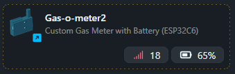

[↓ Switch to English](README_EN.md)

# Integration Templates und Konfigurationen

Templates für die Anbindung des Gas-O-Meter2 an externe Systeme.

## Struktur

```text
integration_templates/
├── zigbee2mqtt/
│   ├── README.md
│   ├── external_converters/gas-o-meter2.js
│   └── device_icons/gas-o-meter2.png
├── nodered/
│   ├── README.md
│   └── gas-o-meter2-ble-flow.json
└── README.md
```

## Verwendung

### [Zigbee2MQTT](./zigbee2mqtt/README.md)



1. `zigbee2mqtt/external_converters/gas-o-meter2.js` nach `<data_path>/external_converters/` kopieren
2. Optional: `zigbee2mqtt/device_icons/gas-o-meter2.png` nach `<data_path>/device_icons/` kopieren und im Converter `meta.icon` setzen (siehe [zigbee2mqtt/README.md](./zigbee2mqtt/README.md#schritt-5-optional-device-icon))
3. Zigbee2MQTT neu starten (Log: `Loaded external converter: gas-o-meter2`)
4. ESP: `transfer_mode` Zigbee, Pairing starten → Z2M **Permit join**

Details, Exposes und Troubleshooting: [zigbee2mqtt/README.md](./zigbee2mqtt/README.md)

### [Node-RED (BLE)](./nodered/README.md)

1. `nodered/gas-o-meter2-ble-flow.json` in Node-RED importieren
2. BLE-Config (MAC), MQTT-Broker und **PRESETS** anpassen
3. Deploy

Details: [nodered/README.md](./nodered/README.md)

## Hinweise

- Templates müssen an die lokale Installation angepasst werden (Pfade, Broker, Topics)
- **Zigbee** und **BLE→MQTT** sind getrennte Übertragungswege; nicht parallel dieselben MQTT-Topics ohne Absprache nutzen
